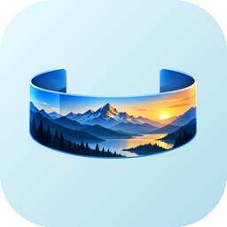

<p align="center"></p>

<h1 align="center">Panoramer</h1>

<p align="center">
Profesjonalne narzędzie do łączenia zdjęć w panoramy · Professional panorama stitcher<br>
Pomysł i wykonanie / Idea and development: <a href="https://redzikowski.com"><b>redzikowski.com</b></a><br>
<a href="https://github.com/BlackSingularities/Panoramer/releases/latest"><b>⬇ Pobierz / Download</b></a>
</p>

---

## 🇵🇱 Po polsku

Panoramer łączy serie zdjęć w panoramy: sferyczne 360°×180°, cylindryczne, prostoliniowe, Panini, „małą planetę” i inne. Silnik jest napisany w Ruście, a nowoczesny interfejs w Tauri 2 + Svelte. Podgląd renderuje karta graficzna (WebGL), więc obracanie i zmiana projekcji działają płynnie w czasie rzeczywistym. Interfejs jest po polsku i angielsku, z podpowiedziami przy każdej opcji.

### Możliwości
- **Pliki wejściowe:** JPEG, TIFF, PNG, WebP, BMP oraz **RAW**: ARW, NEF, CR2, DNG, RAF, ORF, RW2, PEF, SRW, 3FR, IIQ i inne (obsługiwane przez rawloader; CR3 nie jest obsługiwany).
- **Wynik:** z plików RAW powstaje **liniowy DNG** (16-bit float, z zachowanym zakresem tonalnym, do dalszej obróbki w Lightroomie/Camera Raw). Z pozostałych plików powstaje **JPEG**. Można też wybrać ręcznie TIFF 16-bit lub PNG 16-bit, opcjonalnie z przezroczystym tłem.
- **11 projekcji:** sferyczna (equirectangular), cylindryczna, Mercator, prostoliniowa, Panini, rybie oko, stereograficzna, mała planeta, ortograficzna, poprzeczny Mercator (panoramy pionowe), sinusoidalna.
- **Obiektywy:** prostoliniowe i rybie oko (równoodległościowe, równopowierzchniowe, stereograficzne), także z okrągłym kadrem.
- **Automatyczne dopasowanie:**
  - wykrywanie punktów charakterystycznych ORB w wielu skalach,
  - RANSAC,
  - drzewo rozpinające i bundle adjustment (Levenberg–Marquardt) obrotów i ogniskowej,
  - ogniskowa odczytywana z EXIF albo szacowana automatycznie.
- **Interaktywny widok:**
  - przeciąganie panoramy (chwycony punkt podąża za kursorem),
  - panel nawigacji na ekranie (przytrzymaj, aby płynnie obracać),
  - narzędzia: ustaw środek, wypoziomuj horyzont, wyprostuj pion,
  - obrót o 90°/180° i odbicia,
  - kadrowanie myszą,
  - cofnij/ponów, siatka i obrysy zdjęć.
- **Projekcja automatyczna** (domyślnie): program sam dobiera projekcję do zasięgu panoramy.
- **Prostowanie horyzontu.**
- **Korekcja fotometryczna:** wyrównanie ekspozycji, balansu kolorów i usuwanie winietowania.
- **Mieszanie wielopasmowe** (piramidy Laplace'a) i wybór szwów. Opcjonalnie wtapianie liniowe lub ostre szwy.
- **Kadrowanie** automatyczne (największy prostokąt bez pustych obszarów) lub ręczne.
- **Metadane GPano** dla panoram 360°: Google Photos, Facebook i przeglądarki VR rozpoznają je automatycznie.
- **Tryb wiersza poleceń** do pracy wsadowej.

### Instalacja
Pobierz z [Releases](https://github.com/BlackSingularities/Panoramer/releases/latest) jeden z plików:
- `Panoramer-x.y.z-setup-x64.exe` (instalator),
- `…-portable-x64.exe` (wersja przenośna, bez instalacji).

### Jak używać
1. Dodaj zdjęcia (przycisk albo przeciągnij pliki/folder do okna).
2. Kliknij **Dopasuj zdjęcia**.
3. Wybierz projekcję. Podgląd odświeża się na bieżąco, a przeciągając go zmienisz kierunek widoku.
4. Kliknij **Renderuj i zapisz…**.

Wskazówka: zdjęcia powinny nachodzić na siebie w 20–40%. Jeśli w zdjęciach nie ma danych EXIF, ustaw ręcznie kąt widzenia.

---

## 🇬🇧 English

Panoramer stitches photo series into panoramas: spherical 360°×180°, cylindrical, rectilinear, Panini, little planet and more. The engine is written in Rust and the modern UI uses Tauri 2 + Svelte with a GPU (WebGL) real-time preview. Polish/English interface with tooltips for every option.

### Features
- **Input:** JPEG, TIFF, PNG, WebP, BMP and **RAW**: ARW, NEF, CR2, DNG, RAF, ORF, RW2, PEF, SRW, 3FR, IIQ… (CR3 is not supported).
- **Output:** **linear DNG** (16-bit float, keeps highlight headroom) when the sources are RAW, **JPEG** otherwise. You can also pick TIFF/PNG 16-bit, optionally with transparency.
- **11 projections**, rectilinear and fisheye lens models (including circular fisheye).
- **Alignment:** ORB features, RANSAC, maximum spanning tree and Levenberg–Marquardt bundle adjustment. Focal length comes from EXIF or is estimated automatically.
- **Horizon levelling**, plus interactive yaw/pitch/roll.
- **Exposure, colour and vignetting compensation**; multi-band blending; automatic or manual crop.
- **GPano XMP metadata** for 360° viewers.
- **Command line mode.**

### Command line
```
panoramer --cli -p equirectangular --full-sphere -o pano.jpg C:\photos\set1
panoramer --cli -p cylindrical --scale 50 -o pano.dng *.ARW
panoramer --help
```

### Building
Requirements: Rust, Node.js 22.
```
npm ci
npx tauri build
```
Releases are built by GitHub Actions: pushing a `v*` tag produces the NSIS installer (Polish/English) and the portable build.

## License
GPL-3.0-or-later.
